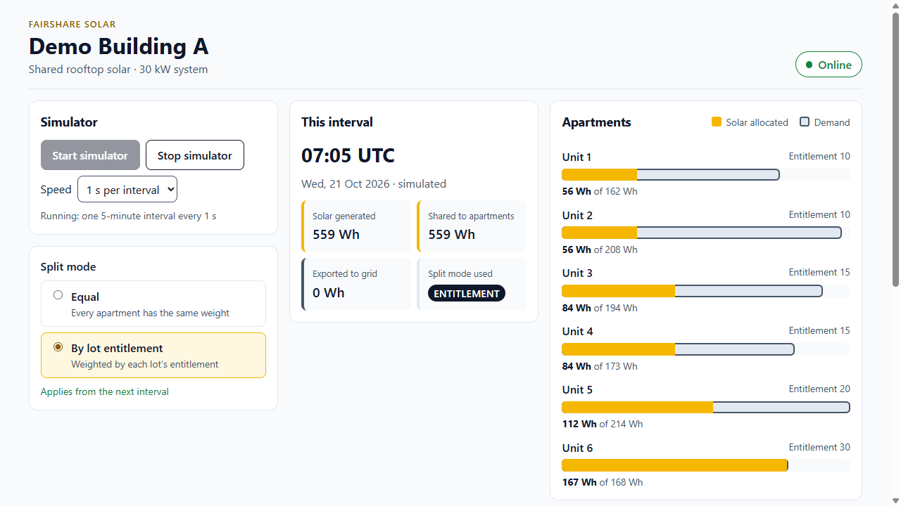
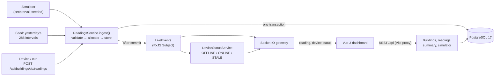

# FairShare Solar

A small full-stack app that takes simulated telemetry from one apartment building's shared rooftop solar system, splits each 5-minute interval of solar energy fairly between the apartments, stores it in PostgreSQL, and streams the result live to a Vue 3 dashboard. Every interval adds up exactly, to the watt-hour.

**NestJS 11 · Prisma 6 · PostgreSQL 17 · Socket.IO · Vue 3.5 · Jest · Vitest · Cypress**



*Above: 07:05 simulated, "By lot entitlement" mode. Solar is scarce, so each apartment's share follows its entitlement (10/10/15/15/20/30 → 56/56/84/84/112/167 Wh).*

## Why I built this

I'm applying for the Full Stack Software Engineer role at **Allume Energy**. Allume's **SolShare** shares one rooftop solar system between the apartments in a building, and the role works across NestJS, Vue 3, PostgreSQL and fleets of connected devices. I wanted to show that I can work in that stack on a problem shaped like theirs: device telemetry in, a fair and exact split, stored safely, streamed live, and tested properly.

> **Disclaimer.** This is an independent demo. It is not affiliated with or endorsed by Allume Energy, and it uses no Allume code, data, branding or logos. The allocation algorithm is my own simplified model, not Allume's, and all data is simulated.

## Quick start (Windows PowerShell)

**Prerequisites:** Node 24 (npm 11) and PostgreSQL 17 running locally (Windows service `postgresql-x64-17`).

**1. Database (one-time).** As the `postgres` superuser, create a dev role and two databases. Choose your own password; `CREATEDB` lets `prisma migrate dev` create its shadow database.

```powershell
& "C:\Program Files\PostgreSQL\17\bin\psql.exe" -U postgres -c "CREATE ROLE fairshare LOGIN PASSWORD '<choose-a-dev-password>' CREATEDB;"
& "C:\Program Files\PostgreSQL\17\bin\psql.exe" -U postgres -c "CREATE DATABASE fairshare_dev OWNER fairshare;"
& "C:\Program Files\PostgreSQL\17\bin\psql.exe" -U postgres -c "CREATE DATABASE fairshare_test OWNER fairshare;"
```

**2. Environment files** (git-ignored). Copy the example twice, put your password in both, and point `.env.test` at `fairshare_test`. If the password contains URL-reserved characters, percent-encode them: `<` → `%3C`, `>` → `%3E`, `@` → `%40`, `#` → `%23`, `%` → `%25`, `/` → `%2F`, `:` → `%3A`.

```powershell
Copy-Item api\.env.example api\.env
Copy-Item api\.env.example api\.env.test
```

**3. Install, set up the database, run.**

```powershell
npm.cmd install
npm.cmd run db:setup
npm.cmd run dev
```

Open **http://localhost:5173**. `db:setup` applies the migrations and seeds *Demo Building A* (30 kW, six apartments) plus yesterday's 288 simulated intervals. Click **Start simulator**: one 5-minute interval arrives every 2 s (1 s and 5 s are selectable), and a simulated day takes about 10 minutes at the default speed.

> Simulated time is **UTC, treated as local time** for the demo: the sun rises at 06:00 UTC. The simulated clock runs ahead of real time.

## Architecture



- **One ingestion path** (ADR-004): the simulator, the seed and HTTP all go through `ReadingsService.ingest()`. It runs the checks in a fixed order (DTO, 5-minute alignment, building, capacity, exactly one demand per apartment), allocates, and stores the reading, demands and allocations in one Prisma transaction.
- **Idempotent** (ADR-006): `(deviceId, intervalStart)` is unique, and a sha256 payload hash decides the rest. The same reading again returns **200 replay** and writes nothing. A different reading for the same interval returns **409**. A race that hits the unique key (`P2002`) gets the same treatment.
- **Split mode applies from the next interval** (ADR-003): each reading stores the `splitModeUsed`, so history never changes.
- **Integers everywhere** (ADR-001): energy is integer Wh, with database `CHECK` constraints behind the validation.
- **Live**: the `reading` event is emitted only after commit and never for replays. `device-status` is emitted only when the status changes, and sent to each client as it connects.
- **Daily summary**: totals come from Postgres `aggregate` / `groupBy` over the UTC day; percentages are rounded to 1 decimal only in the response.

Decisions and trade-offs: [DECISIONS.md](DECISIONS.md) (7 ADRs plus a build log). On-call: [RUNBOOK.md](RUNBOOK.md).

## Allocation model

Each interval's solar is shared **in proportion to weight**: 1 each in *Equal* mode, the lot entitlement in *By lot entitlement* mode. **Nobody gets more than they're using right now.** Energy one apartment can't use is shared again among those still wanting more ("water-filling"). Only energy that nobody can use is exported to the grid. Rounding is done in whole Wh: each apartment gets the floor of its exact share, and any leftover Wh go one at a time by largest fractional remainder.

Invariants, each with a test:

| | Invariant |
|---|---|
| I1 | Conservation: allocated + exported = solar, exactly |
| I2 | Nobody gets more than their demand |
| I3 | Export only when every demand is fully met |
| I4 | When solar is scarce, every share is within 1 Wh of its proportional share |
| I5 | Deterministic, and independent of input order |
| I6 | Every output is a whole number ≥ 0 |

When solar exceeds demand, both modes give the same result, because everyone is fully supplied. The modes only differ while solar is scarce (early morning and late afternoon in the simulated day).

## Testing

| Layer | Command | Covers |
|---|---|---|
| API unit (Jest, 100) | `npm.cmd run test -w api` | Allocation engine: 7 worked examples, I1–I6, 2 × 1,000 seeded property cases, every `RangeError`. Time helpers, payload hash, solar/demand profiles, reading generator, stale logic and simulator (fake timers) |
| API e2e (Jest + Supertest, 75) | `npm.cmd run test:e2e -w api` | Against `fairshare_test`: 201 / 200 replay / 409 / concurrent races / forced `P2002`, every 400 case, 404s, split-mode snapshot, hand-calculated summary, DB `CHECK`s, live event bus, simulator validation, seed history replay |
| Web unit (Vitest, 9) | `npm.cmd run test:unit -w web -- --run` | `ApartmentBars` meters and aria values; `SplitModeToggle` PATCH, revert on error (mocked `fetch`) |
| Smoke (Cypress, 1) | `npm.cmd run e2e` (with `npm.cmd run dev` running) | Start → Online → switch to entitlement → `ENTITLEMENT` → stop → Stale |

`npm.cmd test` runs the first three in order. `npm.cmd run lint`, `npm.cmd run typecheck` and `npm.cmd run build` cover both workspaces. CI (GitHub Actions, `postgres:17` service) runs install, lint, typecheck, all Jest and Vitest tests, and build. Cypress runs locally only.

The e2e suite applies migrations with `prisma migrate deploy` and truncates every table before each test. It refuses to run against any database other than `fairshare_test`. `npm.cmd run test:e2e:reset -w api` does a full reset of the test database.

## How I used AI

I built this with **Claude Code** as a pair. It scaffolded the workspaces and drafted most of the code, tests and docs, one milestone at a time. Before approving the next milestone, I checked each one myself: reading the diff, running `npm.cmd test` on my machine, and walking the journeys in the browser. The bar for AI-written code was the same as for my own: invariant tests, property tests, e2e tests against a real database, and lint and typecheck clean before every commit.

**A test caught a real mistake.** The brief's own allocation algorithm said to hand out leftover rounding Wh "by weight, descending". The engine was written test-first, and the invariant test I4 ("within 1 Wh of the proportional share") failed on it. At 10 Wh with weights 2/1/1 it gave 6/2/2, not 5/3/2, and with many apartments a second proportional round could pile several Wh onto one heavy apartment. The fix (largest-remainder rounding) kept all seven worked examples unchanged and is recorded in [ADR-007](DECISIONS.md).

**Guardrails for autonomous work.** [`CLAUDE.md`](CLAUDE.md) sets the rules the agent works under:
- Rules: one milestone at a time, lint + typecheck + tests green before every commit, never weaken a test, pinned versions only, hands off `.env` files, the `postgres` superuser and dev data, never push.
- Stop conditions: the same step fails twice; it needs a secret, consent or a database reset; it wants to add a dependency, or change an API shape, the scope or a rule in the brief.
- A local Claude Code permission file (not committed) denies `git push` / `config` / `reset --hard` / `clean` / `rebase`, `prisma migrate reset`, `psql` as `postgres`, `DROP DATABASE`, and deletes outside the repo.
- Prisma 6.19 has its own guard: it refuses `migrate reset` from an AI agent without explicit consent. The e2e setup was changed to `migrate deploy` plus a truncate step that only ever runs on `fairshare_test`.

**Other things the process caught:**
- A test that forced the `P2002` race branch, because the plain concurrency test passed whichever way the race went.
- A legend CSS bug found during the browser check.
- A measurement showing that with these numbers the split modes only differ in short scarce windows. I kept the brief's numbers and timed the demo recording to the morning ([DECISIONS.md](DECISIONS.md)).

## What I'd do next

- Device ingest over **MQTT / AWS IoT Core** instead of HTTP, keeping the same idempotent ingest service
- **Time-series storage** (Timestream or TimescaleDB) for readings, with Postgres keeping buildings, apartments and allocations
- Batteries, tariffs and dollar savings; per-building time zones instead of "UTC as local"
- Auth and more than one building in the UI
- Deploy with infrastructure as code; run Cypress in CI
- Generate the web app's types from an OpenAPI document instead of duplicating them (ADR-005)
- Upgrade to NestJS 12 (ESM) and Prisma 7 (driver adapters), then TypeScript 7 once ts-jest supports it (ADR-002)
- A sparkline of the day's solar vs export (cut for time)

## Recording the demo segment

The modes only differ while solar is scarce. In the morning, Unit 6 (entitlement 30) gets about twice its Equal share. To show it:
1. Run the simulator at **1 s** until "This interval" shows about **06:15**, then **Stop**.
2. Start recording. **Start**: the pill turns Online and the bars start filling.
3. At about **06:30**, switch to **By lot entitlement**.
4. At about **07:00**, **Stop**. The pill shows **Stale** 3–4 s later (three missed 1 s intervals).

## Repository layout

```
api/   NestJS 11 API (Prisma schema, migrations and seed in api/prisma)
web/   Vue 3 dashboard (Vite, Vitest, Cypress)
docs/  dashboard screenshot
.github/workflows/ci.yml
DECISIONS.md  RUNBOOK.md  CLAUDE.md  PROJECT_BRIEF.md
```
